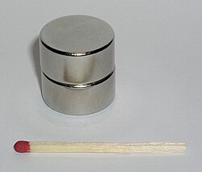
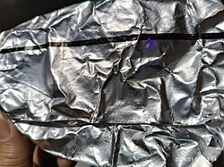

# Mi041: Warum ein Magnet so langsam durch ein Kupferrohr fällt, obwohl Kupfer nicht magnetisch ist

Aus der Folge „Minkorrekt Folge 41 „Die falsche 42““ von [Methodisch inkorrekt!](http://www.minkorrekt.de) vom 06.01.2015.

Das Experiment steht in der Folge 1:30:18 bis 1:47:04 (nach den Kapitelmarken).

Interessen: Tricks und Zauberei Handy und Technik

Fachgebiet: Physik

Material: Magnet <small lang="en">magnet</small> Alufolie und Folie <small lang="en">aluminium foil and foil</small> Braucht Spezialmaterial

[Bilder und ihre Quellen](../materials.md)

## Zusammenfassung

- **Was man tut:** Man wirft einen starken Magneten oben in ein senkrechtes Kupferrohr und lässt ihn hindurchfallen. Unten fängt man ihn wieder auf. (1:31:48) <!-- cite mi-041 ⏱5508.4 paragraph ⏱5508.4 -->
- **Was man braucht:** Man braucht ein Kupferrohr oder ein anderes Metallrohr und einen starken Magneten. Ein großer Neodym-Magnet geht auch mit einer Rolle Alufolie. (1:43:13) <!-- cite mi-041 ⏱6193.8 paragraph ⏱6193.8 -->
- **Was passiert:** Obwohl Kupfer nicht magnetisch ist, fällt der Magnet sehr langsam durch das Rohr und schwebt fast. Man kann ihn unten problemlos auffangen. (1:32:23) <!-- cite mi-041 ⏱5543.1 paragraph ⏱5543.1 -->

Warum? (zum Aufklappen)

<strong>Warum:</strong> Für das Rohr ändert sich das Magnetfeld des fallenden Magneten. Das induziert im Rohr einen Kreisstrom wie beim Fahrraddynamo. Nach der Lenzschen Regel wirkt sein Magnetfeld der Ursache entgegen und bremst den Magneten. (1:33:05) <!-- cite mi-041 ⏱5585.7 paragraph ⏱5585.7 -->

Die Zeiten in Klammern zeigen, wo die Folge davon spricht.

[Zur Übersicht](../index.md)

<!-- Generated by pac publish experiments. Do not edit; the next run overwrites it. -->
