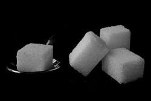

# Mi045: Warum ein Laserstrahl in Zuckerwasser unter normalem Wasser eine Kurve macht

Aus der Folge „Minkorrekt Folge 45 „Funniest corn to cook““ von [Methodisch inkorrekt!](http://www.minkorrekt.de) vom 24.02.2015.

Das Experiment steht in der Folge 1:19:52 bis 1:34:08 (nach den Kapitelmarken).

Interessen: Handy und Technik

Fachgebiet: Physik

Material: Zucker Wasser Papier und Karton Becher, Tasse, Schüssel, Topf Laserpointer Braucht Spezialmaterial

[Bilder und ihre Quellen](../materials.md)

## Zusammenfassung

- **Was man tut:** Man löst etwa ein Kilogramm Zucker in einem Liter Wasser und gießt vorsichtig über eine Pappe normales Wasser darüber. Dann macht man das Licht aus und leuchtet mit einem Laserpointer waagrecht von der Seite in das Gefäß. (1:21:58) <!-- cite mi-045 ⏱4918.3 paragraph ⏱4918.3 -->
- **Was man braucht:** Man braucht etwa 1 kg Zucker, Wasser, ein Stück Pappe, ein Gefäß und einen Laserpointer, der den deutschen Vorgaben entspricht. Ein großes, eckiges Gefäß wie ein Aquarium ist besser als ein kleines rundes Glas. (1:22:03) <!-- cite mi-045 ⏱4923.3 paragraph ⏱4923.3 -->
- **Was passiert:** Im Wasser sieht man Schlieren. Der waagrechte Laserstrahl krümmt sich nach unten, wo das Zuckerwasser stärker wird, und sieht fast wie ein S aus. (1:24:09) <!-- cite mi-045 ⏱5049.8 paragraph ⏱5049.8 -->

Warum? (zum Aufklappen)

<strong>Warum:</strong> Nach dem Snellschen Brechungsgesetz knickt Licht beim Übergang in ein optisch dichteres Medium ab. Nach unten hin steigt der Zuckergehalt und damit der Brechungsindex. Darum knickt der Strahl immer weiter ab und läuft in einer Kurve. (1:28:40) <!-- cite mi-045 ⏱5320.2 paragraph ⏱5320.2 -->

## Videos

<iframe src="https://www.youtube-nocookie.com/embed/9lGofeuGFyc" title="Laserexperiment aus Methodisch inkorrekt Folge 45" loading="lazy" allow="accelerometer; autoplay; clipboard-write; encrypted-media; gyroscope; picture-in-picture; web-share" referrerpolicy="strict-origin-when-cross-origin" allowfullscreen></iframe>

[Laserexperiment aus Methodisch inkorrekt Folge 45](https://www.youtube.com/watch?v=9lGofeuGFyc) (Experiment-Video, auf YouTube)

<iframe src="https://www.youtube-nocookie.com/embed/D_TVw5kUTAI?start=4792" title="methodisch inkorrekt Folge 45" loading="lazy" allow="accelerometer; autoplay; clipboard-write; encrypted-media; gyroscope; picture-in-picture; web-share" referrerpolicy="strict-origin-when-cross-origin" allowfullscreen></iframe>

[methodisch inkorrekt Folge 45](https://www.youtube.com/watch?v=D_TVw5kUTAI&t=4792s) (Folge als Video, auf YouTube)

Die Zeiten in Klammern zeigen, wo die Folge davon spricht.

[Zur Übersicht](../index.md)

<!-- Generated by pac publish experiments. Do not edit; the next run overwrites it. -->
