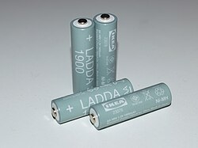

# Mi049: Wie zwei Apfelstücke mit Kupfer- und Zinkblech eine kleine Uhr antreiben

Aus der Folge „Minkorrekt Folge 49 „spontane Bierbatterie““ von [Methodisch inkorrekt!](http://www.minkorrekt.de) vom 28.04.2015.

Das Experiment steht in der Folge 1:26:25 bis 1:44:10 (nach den Kapitelmarken).

Interessen: Handy und Technik Essen und Trinken

Fachgebiet: Chemie Physik

Material: Essig und Säure <small lang="en">vinegar and acid</small> Andere Lebensmittel Batterie und Kabel <small lang="en">battery and electrical cable</small> Braucht Spezialmaterial

[Bilder und ihre Quellen](../materials.md)

## Zusammenfassung

- **Was man tut:** Man schneidet zwei Stücke aus einem Apfel und steckt in jedes ein Kupfer- und ein Zinkblech. Dann verbindet man den Minuspol des einen Stücks mit dem Pluspol des anderen (Reihenschaltung) und schließt die Uhr an, rot an Kupfer. (1:30:01) <!-- cite mi-049 ⏱5401.4 paragraph ⏱5401.4 -->
- **Was man braucht:** Man braucht eine Zitrone oder einen sauren Apfel, je zwei Kupfer- und Zinkbleche, eine kleine LCD-Uhr mit Kabeln und nach Wunsch ein Voltmeter. Der Bausatz stammt von der Experimenta Heilbronn. (1:27:46) <!-- cite mi-049 ⏱5266.9 paragraph ⏱5266.9 -->
- **Was passiert:** Die Uhr läuft. Mit nur einem Apfelstück flackert sie nur, und erst zwei Stücke reichen. Das Voltmeter zeigt knapp 1,9 Volt. (1:31:02) <!-- cite mi-049 ⏱5462.9 paragraph ⏱5462.9 -->

Warum? (zum Aufklappen)

<strong>Warum:</strong> Die Säure im Apfel greift beide Metalle an, das Zink aber stärker. Darum hat das Zink einen Elektronenüberschuss (Minuspol), und die Elektronen fließen über die Uhr zum Kupfer (Pluspol). Am Kupfer entsteht dabei Wasserstoff. (1:31:48) <!-- cite mi-049 ⏱5508.3 paragraph ⏱5508.3 -->

## Videos

<iframe src="https://www.youtube-nocookie.com/embed/0RjLbxSWf40?start=5185" title="methodisch inkorrekt Folge 49" loading="lazy" allow="accelerometer; autoplay; clipboard-write; encrypted-media; gyroscope; picture-in-picture; web-share" referrerpolicy="strict-origin-when-cross-origin" allowfullscreen></iframe>

[methodisch inkorrekt Folge 49](https://www.youtube.com/watch?v=0RjLbxSWf40&t=5185s) (Folge als Video, auf YouTube)

Die Zeiten in Klammern zeigen, wo die Folge davon spricht.

[Zur Übersicht](../index.md)

<!-- Generated by pac publish experiments. Do not edit; the next run overwrites it. -->
