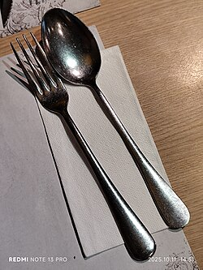

# Mi056: Warum sich Teeblätter nach dem Umrühren in der Mitte am Boden vom Glas sammeln

Aus der Folge „Minkorrekt Folge 56 „Verfassungsfeindlich““ von [Methodisch inkorrekt!](http://www.minkorrekt.de) vom 04.08.2015.

Das Experiment steht in der Folge 1:34:57 bis 1:52:53 (nach den Kapitelmarken).

Interessen: Essen und Trinken

Fachgebiet: Physik

Material: Glas und Flasche Wasser Andere Lebensmittel Löffel und Besteck Becher, Tasse, Schüssel, Topf

[Bilder und ihre Quellen](../materials.md)

## Zusammenfassung

- **Was man tut:** Man gibt Teeblätter in ein Glas mit kaltem Wasser und rührt kurz mit einem Löffel um. Dann zieht man den Löffel heraus und schaut auf den Boden des Glases. (1:35:50) <!-- cite mi-056 ⏱5750.9 paragraph ⏱5750.9 -->
- **Was man braucht:** Man braucht ein Wasserglas, kaltes Wasser, Tee (lose Blätter oder aus einem Teebeutel) und einen Löffel. Eine Tasse Tee geht auch. (1:35:33) <!-- cite mi-056 ⏱5733.6 paragraph ⏱5733.6 -->
- **Was passiert:** Nach ein paar Sekunden sammeln sich die Teeblätter am Boden genau in der Mitte des Strudels zu einem ordentlichen Häufchen. Am Anfang steigen in der Mitte einzelne Blätter auf, am Rand sinken welche ab. (1:36:45) <!-- cite mi-056 ⏱5805.2 paragraph ⏱5805.2 -->

Warum? (zum Aufklappen)

<strong>Warum:</strong> Am Boden bremst die Reibung das Wasser, oben drückt die Zentrifugalkraft es nach außen. Es fließt an der Wand hinab, am Boden zur Mitte und dort wieder hoch. Die schwereren Blätter steigen nicht mit und bleiben in der Mitte liegen. (1:38:59) <!-- cite mi-056 ⏱5939.5 paragraph ⏱5939.5 -->

## Videos

<iframe src="https://www.youtube-nocookie.com/embed/vU14qDiASOc" title="Minkorrekt 56 - Experiment: Urantee-Anreicherung" loading="lazy" allow="accelerometer; autoplay; clipboard-write; encrypted-media; gyroscope; picture-in-picture; web-share" referrerpolicy="strict-origin-when-cross-origin" allowfullscreen></iframe>

[Minkorrekt 56 - Experiment: Urantee-Anreicherung](https://www.youtube.com/watch?v=vU14qDiASOc) (Experiment-Video, auf YouTube)

<iframe src="https://www.youtube-nocookie.com/embed/W86AZBvbvrI?start=5697" title="methodisch inkorrekt Folge 56" loading="lazy" allow="accelerometer; autoplay; clipboard-write; encrypted-media; gyroscope; picture-in-picture; web-share" referrerpolicy="strict-origin-when-cross-origin" allowfullscreen></iframe>

[methodisch inkorrekt Folge 56](https://www.youtube.com/watch?v=W86AZBvbvrI&t=5697s) (Folge als Video, auf YouTube)

Die Zeiten in Klammern zeigen, wo die Folge davon spricht.

[Zur Übersicht](../index.md)

<!-- Generated by pac publish experiments. Do not edit; the next run overwrites it. -->
