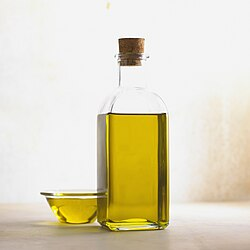

# Mi063: Tinte tropft durch Öl ins Wasser, und Rotwein und Wasser tauschen ihr Glas

Aus der Folge „Minkorrekt Folge 63 „Physics attitude”“ von [Methodisch inkorrekt!](http://www.minkorrekt.de) vom 24.11.2015.

Das Experiment steht in der Folge 1:23:26 bis 1:46:35 (nach den Kapitelmarken).

Interessen: Essen und Trinken

Fachgebiet: Physik Chemie

Material: Glas und Flasche Wasser Speiseöl Andere Lebensmittel Papier und Karton Becher, Tasse, Schüssel, Topf

[Bilder und ihre Quellen](../materials.md)

## Zusammenfassung

- **Was man tut:** Man gießt Öl auf ein Glas Wasser und tropft Tinte aus einer Patrone darauf. Im zweiten Versuch stellt man ein volles Glas Wasser mit einer Karte kopfüber auf ein volles Glas Rotwein und zieht die Karte ein Stück heraus. (1:25:02) <!-- cite mi-063 ⏱5102.9 paragraph ⏱5102.9 -->
- **Was man braucht:** Man braucht ein Glas Wasser, Sonnenblumenöl und eine Patrone mit blauer Tinte. Für den zweiten Versuch braucht man zwei gleiche Gläser, Rotwein, Leitungswasser, eine Karte und eine Schale gegen die Sauerei. (1:25:05) <!-- cite mi-063 ⏱5105.0 paragraph ⏱5105.0 -->
- **Was passiert:** Das Öl schwimmt oben. Die Tinte bleibt im Öl kugelförmig, sinkt bis zum Wasser, fällt dann in Fäden hinein und zerfällt. Im zweiten Versuch fließt der Wein nach oben und das Wasser nach unten, bis die Gläser den Inhalt tauschen. (1:26:30) <!-- cite mi-063 ⏱5190.3 paragraph ⏱5190.3 -->

Warum? (zum Aufklappen)

<strong>Warum:</strong> Öl hat eine geringere Dichte als Wasser. Tinte ist hydrophil und nicht lipophil, deshalb löst sie sich nur im Wasser. Wein hat durch den Alkohol eine geringere Dichte als Wasser und steigt deshalb nach oben. (1:26:37) <!-- cite mi-063 ⏱5197.0 paragraph ⏱5197.0 -->

Die Zeiten in Klammern zeigen, wo die Folge davon spricht.

[Zur Übersicht](../index.md)

<!-- Generated by pac publish experiments. Do not edit; the next run overwrites it. -->
