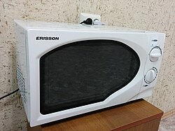

# Mi067: Kochen mit Eis: Warum heißes Wasser im Gurkenglas mit Eis auf dem Deckel wieder kocht

Aus der Folge „Minkorrekt Folge 67 „Fleischgutschein““ von [Methodisch inkorrekt!](http://www.minkorrekt.de) vom 26.01.2016.

Das Experiment steht in der Folge 1:32:43 bis 1:47:01 (nach den Kapitelmarken).

Interessen: Feuer und Knall Haushalt und Alltag

Fachgebiet: Physik

Material: Wasser <small lang="en">water</small> Glas und Flasche <small lang="en">drinking glass and bottle</small> Eis <small lang="en">ice</small> Haushaltsgerät <small lang="en">home appliance</small>

[Bilder und ihre Quellen](../materials.md)

## Zusammenfassung

- **Was man tut:** Man wärmt ein Gurkenglas mit heißem Wasser vor und füllt es dann randvoll mit gerade gekochtem Wasser. Dann schraubt man sofort den Deckel zu, legt Eiswürfel auf den Deckel und wartet etwas. (1:39:21) <!-- cite mi-067 ⏱5961.6 paragraph ⏱5961.6 -->
- **Was man braucht:** Man braucht einen Wasserkocher, ein leeres Gurkenglas mit Deckel, Eiswürfel und etwas Geduld. Glas und Deckel werden sehr heiß, und man kann sich beim Zuschrauben die Finger verbrennen. (1:45:29) <!-- cite mi-067 ⏱6329.2 paragraph ⏱6329.2 -->
- **Was passiert:** Der Deckel zieht sich nach innen. Nach einer Weile steigen große Blasen auf, und das Wasser kocht wieder, obwohl es keine 100 Grad mehr hat. (1:41:22) <!-- cite mi-067 ⏱6082.2 paragraph ⏱6082.2 -->

Warum? (zum Aufklappen)

<strong>Warum:</strong> Die Luft oben im Glas kühlt ab und zieht sich zusammen. So entsteht ein Unterdruck. Bei niedrigerem Druck kocht Wasser schon bei etwa 90 bis 95 Grad, also umgekehrt wie im Schnellkochtopf. (1:40:57) <!-- cite mi-067 ⏱6057.8 paragraph ⏱6057.8 -->

Die Zeiten in Klammern zeigen, wo die Folge davon spricht.

[Zur Übersicht](../index.md)

<!-- Generated by pac publish experiments. Do not edit; the next run overwrites it. -->
