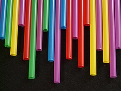
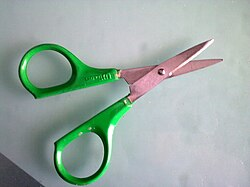
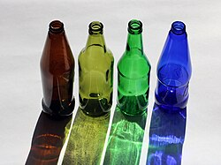
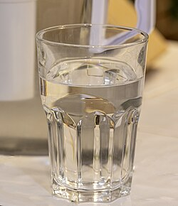
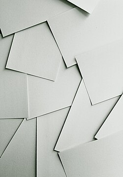

# Mi087: Wie ein geknickter Strohhalm beim Pusten Wasser aus dem Glas hochzieht und versprüht

Aus der Folge „Minkorrekt Folge 87 „Zum Harzer““ von [Methodisch inkorrekt!](http://www.minkorrekt.de) vom 13.12.2016.

Das Experiment steht in der Folge 1:03:55 bis 1:17:28 (nach den Kapitelmarken).

Interessen: Haushalt und Alltag Musik und Klang

Fachgebiet: Physik

Material: Strohhalm <small lang="en">drinking straw</small> Beutel, Schere, Klebeband <small lang="en">bag, scissors, adhesive tape</small> Glas und Flasche <small lang="en">drinking glass and bottle</small> Wasser <small lang="en">water</small> Papier und Karton <small lang="en">paper and cardboard</small>

[Bilder und ihre Quellen](../materials.md)

## Zusammenfassung

- **Was man tut:** Man schneidet einen Strohhalm bei etwa einem Drittel fast durch und knickt ihn um 90 Grad ab. Das kurze Ende steckt man etwa einen Zentimeter ins Wasserglas und bläst durch das lange Ende über den Knick hinweg. (1:05:15) <!-- cite mi-087 ⏱3915.8 paragraph ⏱3915.8 -->
- **Was man braucht:** Man braucht einen dünnen Strohhalm, eine Schere und ein Glas mit Wasser. Weil Wasser herausgesprüht wird, hält man Abstand zu Technik und Steckdosen und legt einen Schutzkarton aus. (1:04:47) <!-- cite mi-087 ⏱3887.8 paragraph ⏱3887.8 -->
- **Was passiert:** Der Ton steigt, je stärker man bläst, und das Wasser steigt im kurzen Halm nach oben. Oben reißt der Luftstrom es mit und sprüht es als feinen Nebel heraus, besonders wenn man die Austrittsöffnung zusammendrückt. (1:07:44) <!-- cite mi-087 ⏱4064.3 paragraph ⏱4064.3 -->

Warum? (zum Aufklappen)

<strong>Warum:</strong> Nach Bernoulli sinkt der Druck dort, wo Luft schnell strömt. Der Unterdruck über der Öffnung zieht das Wasser hoch, wie bei einer Wasserstrahlpumpe. (1:10:37) <!-- cite mi-087 ⏱4237.9 paragraph ⏱4237.9 -->

Die Zeiten in Klammern zeigen, wo die Folge davon spricht.

[Zur Übersicht](../index.md)

<!-- Generated by pac publish experiments. Do not edit; the next run overwrites it. -->
