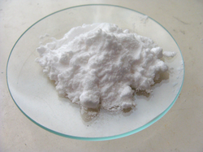
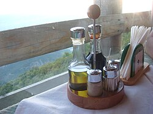
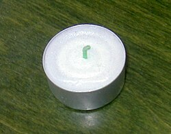

# Mi101: Wie man mit unsichtbarem Gas aus Backpulver und Essig ein Teelicht auslöscht

Aus der Folge „Minkorrekt Folge 101 “Fortschritt ist Rückschritt”“ von [Methodisch inkorrekt!](http://www.minkorrekt.de) vom 14.07.2017.

Das Experiment steht in der Folge 1:45:23 bis 1:56:51 (nach den Kapitelmarken).

Interessen: Feuer und Knall Tricks und Zauberei

Fachgebiet: Chemie Physik

Material: Backpulver und Natron Essig und Säure Becher, Tasse, Schüssel, Topf Kerze, Teelicht, Feuerzeug

[Bilder und ihre Quellen](../materials.md)

## Zusammenfassung

- **Was man tut:** Man füllt ein Päckchen Backpulver in eine große Tasse, gibt Essigessenz dazu und deckt sie mit der Hand ab. Dann kippt man das unsichtbare Gas langsam über ein brennendes Teelicht in einem Schälchen. (1:51:31) <!-- cite mi-101 ⏱6691.7 paragraph ⏱6691.7 -->
- **Was man braucht:** Man braucht ein Päckchen Backpulver, Essigessenz (oder Essig), eine große Tasse, ein kleines Schälchen und ein Teelicht. (1:51:31) <!-- cite mi-101 ⏱6691.7 paragraph ⏱6691.7 -->
- **Was passiert:** Das Gemisch schäumt stark und riecht nach Essig. Beim Ausgießen sieht man nichts, aber die Flamme geht sofort aus, fast als hätte man sie ausgepustet. (1:54:21) <!-- cite mi-101 ⏱6861.1 paragraph ⏱6861.1 -->

Warum? (zum Aufklappen)

<strong>Warum:</strong> Das Natriumhydrogencarbonat im Backpulver reagiert mit der Säure zu Salz und viel CO2. CO2 ist schwerer als Luft, sammelt sich in der Tasse, verdrängt beim Ausgießen den Sauerstoff an der Flamme, und sie erlischt. (1:50:49) <!-- cite mi-101 ⏱6649.0 paragraph ⏱6649.0 -->

Die Zeiten in Klammern zeigen, wo die Folge davon spricht.

[Zur Übersicht](../index.md)

<!-- Generated by pac publish experiments. Do not edit; the next run overwrites it. -->
