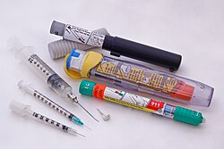
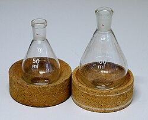
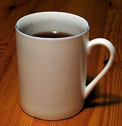

# Mi125: Warum heißes Wasser in einer zugehaltenen Spritze kocht, wenn man den Kolben zieht

Aus der Folge „Minkorrekt Folge 125 "Hobbyspritze"“ von [Methodisch inkorrekt!](http://www.minkorrekt.de) vom 31.07.2018.

Das Experiment steht in der Folge 3:08:05 bis 3:19:14 (nach den Kapitelmarken).

Interessen: Feuer und Knall

Fachgebiet: Physik

Material: Spritze <small lang="en">syringe</small> Braucht Spezialmaterial Becher, Tasse, Schüssel, Topf <small lang="en">beaker, cup, bowl, stock pot</small> Wasser <small lang="en">water</small>

[Bilder und ihre Quellen](../materials.md)

## Zusammenfassung

- **Was man tut:** Man saugt etwa 3 bis 4 Milliliter heißes Wasser möglichst blasenfrei in eine Spritze ohne Nadel. Dann hält man die Öffnung mit dem Daumen zu und zieht den Kolben nach außen. (3:10:28) <!-- cite mi-125 ⏱11428.6 paragraph ⏱11428.6 -->
- **Was man braucht:** Man braucht eine einfache Plastikspritze, zum Beispiel 10 Milliliter (mehr Volumen ist vielleicht besser), und eine Tasse mit Wasser, das gekocht hat und etwas abgekühlt ist. (3:08:18) <!-- cite mi-125 ⏱11298.0 paragraph ⏱11298.0 -->
- **Was passiert:** Das Wasser in der Spritze beginnt plötzlich zu sieden und blubbert richtig, obwohl es deutlich unter 100 Grad hat. Mit dem Kolben schaltet man das Kochen an und aus. (3:11:17) <!-- cite mi-125 ⏱11477.3 paragraph ⏱11477.3 -->

Warum? (zum Aufklappen)

<strong>Warum:</strong> Der Siedepunkt hängt von der Temperatur und vom äußeren Druck ab. Beim Ziehen entsteht ein Unterdruck, und bei weniger Druck siedet Wasser schon bei niedrigerer Temperatur, wie auf dem Mount Everest bei 65 Grad. (3:12:01) <!-- cite mi-125 ⏱11521.2 paragraph ⏱11521.2 -->

## Videos

<iframe src="https://www.youtube-nocookie.com/embed/rmKcxgfEpd4" title="Experiment aus Minkorrekt 125" loading="lazy" allow="accelerometer; autoplay; clipboard-write; encrypted-media; gyroscope; picture-in-picture; web-share" referrerpolicy="strict-origin-when-cross-origin" allowfullscreen></iframe>

[Experiment aus Minkorrekt 125](https://www.youtube.com/watch?v=rmKcxgfEpd4) (Experiment-Video, auf YouTube)

Die Zeiten in Klammern zeigen, wo die Folge davon spricht.

[Zur Übersicht](../index.md)

<!-- Generated by pac publish experiments. Do not edit; the next run overwrites it. -->
