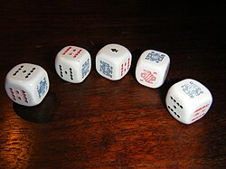

# Mi137: Warum ein Laser durch einen Spalt zwischen zwei Spielkarten viele Punkte macht

Aus der Folge „Minkorrekt Folge 137 "Aufgespritet"“ von [Methodisch inkorrekt!](http://www.minkorrekt.de) vom 20.02.2019.

Das Experiment steht in der Folge 1:47:36 bis 1:58:20 (nach den Kapitelmarken).

Interessen: Handy und Technik

Fachgebiet: Physik

Material: Laserpointer Kartenspiel, Würfel, Brettspiel Papier und Karton Braucht Spezialmaterial

[Bilder und ihre Quellen](../materials.md)

## Zusammenfassung

- **Was man tut:** Man hält zwei Spielkarten so dicht nebeneinander, dass nur ein ganz schmaler Spalt bleibt. Im abgedunkelten Raum leuchtet man mit einem Laserpointer durch den Spalt auf eine Wand in zwei bis drei Metern Abstand. (1:48:48) <!-- cite mi-137 ⏱6528.8 paragraph ⏱6528.8 -->
- **Was man braucht:** Man braucht zwei Spielkarten oder Pappe mit einer glatten, scharfen Kante und einen Laserpointer. Das Licht muss von einem Laser kommen, weil man geordnetes, kohärentes Licht braucht. (1:47:47) <!-- cite mi-137 ⏱6467.2 paragraph ⏱6467.2 -->
- **Was passiert:** An der Wand erscheint kein einzelner Punkt und kein Strich. Man sieht eine Reihe aus hellen und dunklen Punkten quer zum Spalt, etwa 10 bis 20 Zentimeter breit, auch dort, wo eigentlich der Schatten der Karten liegt. (1:49:45) <!-- cite mi-137 ⏱6585.2 paragraph ⏱6585.2 -->

Warum? (zum Aufklappen)

<strong>Warum:</strong> Das ist Beugung am Einzelspalt: Nach dem Huygensprinzip geht von jedem Punkt im Spalt eine Elementarwelle aus. Je nach Winkel und Gangunterschied verstärken sich die Wellen (hell) oder löschen sich aus (dunkel). (1:51:20) <!-- cite mi-137 ⏱6680.6 paragraph ⏱6680.6 -->

Die Zeiten in Klammern zeigen, wo die Folge davon spricht.

[Zur Übersicht](../index.md)

<!-- Generated by pac publish experiments. Do not edit; the next run overwrites it. -->
