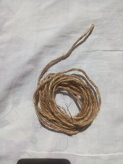

# Mi138: Warum eine Garnrolle mal wegrollt und mal zu dir kommt, wenn du am Faden ziehst

Aus der Folge „Minkorrekt Folge 138 "Muffinbohrer"“ von [Methodisch inkorrekt!](http://www.minkorrekt.de) vom 28.02.2019.

Das Experiment steht in der Folge 2:12:33 bis 2:19:13 (nach den Kapitelmarken).

Interessen: Haushalt und Alltag

Fachgebiet: Physik

Material: Schnur, Faden, Gummiband

[Bilder und ihre Quellen](../materials.md)

## Zusammenfassung

- **Was man tut:** Man legt eine Garnrolle auf die Seite und zieht am Faden: einmal senkrecht nach oben, einmal parallel zum Boden. Dann probiert man vorsichtig verschiedene Winkel aus und sucht den kritischen Winkel. (2:13:35) <!-- cite mi-138 ⏱8015.3 paragraph ⏱8015.3 -->
- **Was man braucht:** Man braucht eine Rolle mit aufgerolltem Faden oder Band, z. B. eine Garnrolle oder eine Geschenkbandrolle. Das Aufgerollte darf den Boden nicht berühren, eine Klopapierrolle eignet sich also nicht. (2:12:54) <!-- cite mi-138 ⏱7974.7 paragraph ⏱7974.7 -->
- **Was passiert:** Zieht man senkrecht nach oben, rollt die Rolle vom Faden weg und wickelt sich ab. Zieht man flach zum Boden, rollt sie auf einen zu und wickelt sich auf. An einem kritischen Winkel kippt die Richtung. (2:13:53) <!-- cite mi-138 ⏱8033.3 paragraph ⏱8033.3 -->

Warum? (zum Aufklappen)

<strong>Warum:</strong> Das Drehmoment entscheidet: Die Rolle dreht sich um den Auflagepunkt. Zieht man oberhalb der Linie vom Auflagepunkt zum Fadenpunkt, rollt sie ab, unterhalb rollt sie auf. Bei der Klopapierrolle fehlt dieser Hebel. (2:15:17) <!-- cite mi-138 ⏱8117.8 paragraph ⏱8117.8 -->

Die Zeiten in Klammern zeigen, wo die Folge davon spricht.

[Zur Übersicht](../index.md)

<!-- Generated by pac publish experiments. Do not edit; the next run overwrites it. -->
