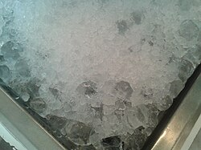

# Mi152: Warum das Wasser im Glas nicht steigt, wenn die Eiswürfel darin schmelzen

Aus der Folge „Minkorrekt Folge 152 "Wärmflaschenzeit"“ von [Methodisch inkorrekt!](http://www.minkorrekt.de) vom 08.10.2019.

Das Experiment steht in der Folge 2:09:16 bis 2:19:52 (nach den Kapitelmarken).

Interessen: Essen und Trinken Tiere und Pflanzen

Fachgebiet: Physik Erde und Weltraum

Material: Glas und Flasche <small lang="en">drinking glass and bottle</small> Wasser <small lang="en">water</small> Eis <small lang="en">ice</small>

[Bilder und ihre Quellen](../materials.md)

## Zusammenfassung

- **Was man tut:** Man legt Eiswürfel in ein Glas Wasser und markiert die Wasserlinie am Glas. Dann wartet man, bis das Eis geschmolzen ist, und prüft die Wasserlinie. (2:09:35) <!-- cite mi-152 ⏱7775.5 paragraph ⏱7775.5 -->
- **Was man braucht:** Ein Wasserglas, Wasser, Eiswürfel und etwas zum Markieren der Wasserlinie am Glas. (2:09:35) <!-- cite mi-152 ⏱7775.5 paragraph ⏱7775.5 -->
- **Was passiert:** Das Eis ist geschmolzen, aber der Wasserspiegel steht genau an der gleichen Markierung wie vorher. (2:10:11) <!-- cite mi-152 ⏱7811.4 paragraph ⏱7811.4 -->

Warum? (zum Aufklappen)

<strong>Warum:</strong> Nach dem archimedischen Prinzip verdrängt schwimmendes Eis so viel Wasser, wie es wiegt. Geschmolzen füllt es genau dieses Volumen. Der Meeresspiegel steigt trotzdem, weil sich wärmeres Wasser ausdehnt und Eis an Land schmilzt. (2:11:19) <!-- cite mi-152 ⏱7879.3 paragraph ⏱7879.3 -->

Die Zeiten in Klammern zeigen, wo die Folge davon spricht.

[Zur Übersicht](../index.md)

<!-- Generated by pac publish experiments. Do not edit; the next run overwrites it. -->
