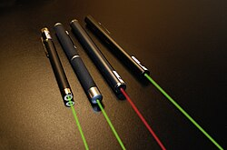
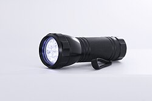

# Mi178: Warum ein Laser in der Badewanne einen dunklen Ring um den hellen Punkt macht

Aus der Folge „Mi178 - "Brennbar oder Royal"“ von [Methodisch inkorrekt!](http://www.minkorrekt.de) vom 10.11.2020.

Das Experiment steht in der Folge 2:45:22 bis 2:54:59 (nach den Kapitelmarken).

Interessen: Handy und Technik Haushalt und Alltag

Fachgebiet: Physik

Material: Laserpointer Braucht Spezialmaterial Lampe und Taschenlampe Wasser

[Bilder und ihre Quellen](../materials.md)

## Zusammenfassung

- **Was man tut:** Man füllt die Badewanne etwa 10 Zentimeter hoch mit Wasser und leuchtet mit einem Laser von oben auf die Wasseroberfläche. Zur Probe kann man mehr Wasser einlassen, die Hand ins Wasser halten oder abdunkeln und an die Decke schauen. (2:45:43) <!-- cite mi-178 ⏱9943.7 paragraph ⏱9943.7 -->
- **Was man braucht:** Man braucht einen Laser (vielleicht geht auch eine Taschenlampe) und eine Badewanne oder ein Waschbecken mit Wasser. Der Boden soll weiß sein und leicht diffus reflektieren, nicht aus Metall. (2:47:27) <!-- cite mi-178 ⏱10047.9 paragraph ⏱10047.9 -->
- **Was passiert:** Am Wannenboden sieht man in der Mitte einen sehr hellen Laserspot. Um ihn liegt ein dunkler Ring von 10 bis 20 Zentimetern, danach wird es wieder hell. (2:46:22) <!-- cite mi-178 ⏱9982.9 paragraph ⏱9982.9 -->

Warum? (zum Aufklappen)

<strong>Warum:</strong> Der Boden streut das Licht in alle Richtungen. Steile Strahlen verlassen das Wasser, darum bleibt der Ring dunkel. Strahlen, die flacher als 49 Grad auf die Oberfläche treffen, reflektiert sie total zurück auf den Boden. (2:48:36) <!-- cite mi-178 ⏱10116.5 paragraph ⏱10116.5 -->

Die Zeiten in Klammern zeigen, wo die Folge davon spricht.

[Zur Übersicht](../index.md)

<!-- Generated by pac publish experiments. Do not edit; the next run overwrites it. -->
