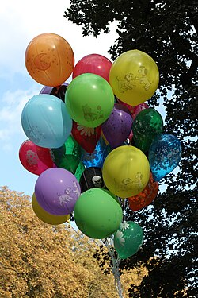

# Mi189: Warum ein Luftballon mit Tesafilm nicht platzt, wenn man mit der Nadel hineinsticht

Aus der Folge „Mi189 - "Spitze der Nahrungspyramide"“ von [Methodisch inkorrekt!](http://www.minkorrekt.de) vom 20.04.2021.

Das Experiment steht in der Folge ab 2:02:53 (nach den Kapitelmarken).

Interessen: Tricks und Zauberei Feuer und Knall

Fachgebiet: Physik

Material: Luftballon <small lang="en">toy balloon</small> Beutel, Schere, Klebeband <small lang="en">bag, scissors, adhesive tape</small>

[Bilder und ihre Quellen](../materials.md)

## Zusammenfassung

- **Was man tut:** Man bläst einen Ballon auf, verknotet ihn und klebt Tesafilm darauf. Dann sticht man mit der Nadel durch den Klebestreifen. Variante: Man klebt drei Streifen als kleines Dreieck und sticht in das freie Loch in der Mitte. (2:05:09) <!-- cite mi-189 ⏱7509.7 paragraph ⏱7509.7 -->
- **Was man braucht:** Man braucht einen Luftballon, Tesafilm und eine spitze Nadel. (2:05:04) <!-- cite mi-189 ⏱7504.1 paragraph ⏱7504.1 -->
- **Was passiert:** Durch den Tesafilm gestochen, platzt der Ballon nicht, nur Luft entweicht. Beim Dreieck reißt das Loch bis zum Klebeband auf, der Ballon schrumpft, und nach drei bis vier Sekunden platzt er mit einem Knall. (2:05:42) <!-- cite mi-189 ⏱7542.5 paragraph ⏱7542.5 -->

Warum? (zum Aufklappen)

<strong>Warum:</strong> Das Gummi steht unter Spannung, ein Stich schafft ein freies Ende, und der Riss wandert explosionsartig: Das gibt den Knall. Der Tesafilm hält das Gummi fest und stoppt den Riss, bis dieser unter dem Klebeband hindurchwandert. (2:06:32) <!-- cite mi-189 ⏱7592.5 paragraph ⏱7592.5 -->

Die Zeiten in Klammern zeigen, wo die Folge davon spricht.

[Zur Übersicht](../index.md)

<!-- Generated by pac publish experiments. Do not edit; the next run overwrites it. -->
