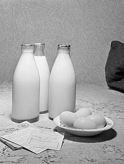

# Mi193: Wie quellende Linsen einen Becher mit hartem Gips von innen sprengen

Aus der Folge „Mi193 - "Pfeffermünztee"“ von [Methodisch inkorrekt!](http://www.minkorrekt.de) vom 15.06.2021.

Das Experiment steht in der Folge 2:03:53 bis 2:15:10 (nach den Kapitelmarken).

Interessen: Tiere und Pflanzen Haushalt und Alltag

Fachgebiet: Biologie Physik

Material: Becher, Tasse, Schüssel, Topf <small lang="en">beaker, cup, bowl, stock pot</small> Wasser <small lang="en">water</small> Andere Lebensmittel Braucht Spezialmaterial

[Bilder und ihre Quellen](../materials.md)

## Zusammenfassung

- **Was man tut:** Man füllt einen Joghurtbecher etwa halb mit Gips und rührt ihn mit Wasser zu einem Brei an. Dann rührt man etwa einen Esslöffel trockene Linsen oder Bohnen unter und lässt alles mehrere Stunden aushärten. (2:05:17) <!-- cite mi-193 ⏱7517.5 paragraph ⏱7517.5 -->
- **Was man braucht:** Man braucht einen Plastikbecher, der nicht splittert, Gips (oder Beton, Spachtelmasse), Wasser, ein Rührhölzchen und trockene Hülsenfrüchte. Eine Unterlage hilft gegen den Staub, und den Becher stellt man zur Sicherheit in die Spüle. (2:03:54) <!-- cite mi-193 ⏱7434.0 paragraph ⏱7434.0 -->
- **Was passiert:** Der Gips härtet unter leichter Wärme aus und wird hart und spröde. Nach einigen Stunden sprengen die quellenden Linsen den Gips, und der Plastikbecher platzt an der Seite auf. (2:09:56) <!-- cite mi-193 ⏱7796.6 paragraph ⏱7796.6 -->

Warum? (zum Aufklappen)

<strong>Warum:</strong> Die Hülsenfrüchte nehmen Restwasser aus dem Gips auf, quellen und keimen, auch im schon harten Gips. Diese Quellkraft erzeugt einen großen Druck. Schon in der Antike spaltete man Felsen so mit nassen Holzkeilen. (2:10:19) <!-- cite mi-193 ⏱7819.2 paragraph ⏱7819.2 -->

Die Zeiten in Klammern zeigen, wo die Folge davon spricht.

[Zur Übersicht](../index.md)

<!-- Generated by pac publish experiments. Do not edit; the next run overwrites it. -->
