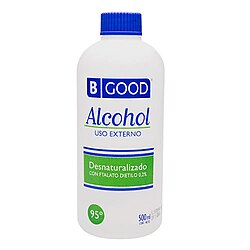
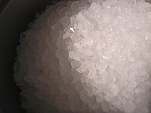

# Mi208: Warum ein Geldschein in Wasser mit Alkohol und Salz brennt und doch heil bleibt

Aus der Folge „Mi208 – „Blaubär-Institut““ von [Methodisch inkorrekt!](http://www.minkorrekt.de) vom 25.01.2022.

Das Experiment steht in der Folge 2:17:01 bis 2:24:29 (nach den Kapitelmarken).

Interessen: Feuer und Knall Tricks und Zauberei Haushalt und Alltag

Fachgebiet: Chemie Physik

Material: Wasser <small lang="en">water</small> Alkohol und Spiritus Braucht Spezialmaterial Salz <small lang="en">table salt</small> Papier und Karton <small lang="en">paper and cardboard</small> Kerze, Teelicht, Feuerzeug <small lang="en">candle, tealight, lighter</small>

[Bilder und ihre Quellen](../materials.md)

## Zusammenfassung

- **Was man tut:** Man mischt Wasser und Alkohol im Verhältnis 1 zu 1 und rührt einen Teelöffel Salz ein. Dann tunkt man einen Geldschein hinein, holt ihn mit einer Zange heraus und zündet ihn an. (2:18:42) <!-- cite mi-208 ⏱8322.3 paragraph ⏱8322.3 -->
- **Was man braucht:** Man braucht 50 Milliliter Wasser, 50 Milliliter Alkohol (Ethanol oder Isopropanol), einen Teelöffel Salz, einen Geldschein, eine Zange und Feuer. Eine Gefahr oder einen Schutz nennen die Hosts nicht. (2:18:49) <!-- cite mi-208 ⏱8329.6 paragraph ⏱8329.6 -->
- **Was passiert:** Der Schein brennt lichterloh mit einer gelben Flamme. Nach einer Weile geht die Flamme von selbst aus, und der Geldschein bleibt unversehrt. (2:19:38) <!-- cite mi-208 ⏱8378.9 paragraph ⏱8378.9 -->

Warum? (zum Aufklappen)

<strong>Warum:</strong> Es brennt nur der Alkoholdampf über der Flüssigkeit. Das Wasser nimmt viel Wärme auf und hält den Schein unter 100 Grad, Zellulose brennt erst bei etwa 170 Grad. Das Natrium im Salz färbt die Flamme gelb. (2:19:46) <!-- cite mi-208 ⏱8386.9 paragraph ⏱8386.9 -->

Die Zeiten in Klammern zeigen, wo die Folge davon spricht.

[Zur Übersicht](../index.md)

<!-- Generated by pac publish experiments. Do not edit; the next run overwrites it. -->
