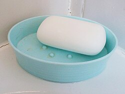

# Mi252: Wie ein Spritzer Spüli im Sprudelwasser feine Ketten aus kleinen Bläschen macht

Aus der Folge „Mi252 – „Moussierpunkt““ von [Methodisch inkorrekt!](http://www.minkorrekt.de) vom 30.05.2023.

Das Experiment steht in der Folge 1:24:14 bis 1:37:15 (nach den Kapitelmarken).

Interessen: Essen und Trinken Haushalt und Alltag

Fachgebiet: Chemie Physik

Material: Glas und Flasche <small lang="en">drinking glass and bottle</small> Wasser <small lang="en">water</small> Spülmittel und Seife <small lang="en">dishwashing liquid and soap</small>

[Bilder und ihre Quellen](../materials.md)

## Zusammenfassung

- **Was man tut:** Man verdünnt etwas Spüli mit Wasser, gießt Sprudelwasser in ein Glas und gibt ein bis zwei Spritzer oder einen Teelöffel davon hinein. Dann rührt man leicht um, wartet ab und gibt bei Bedarf mehr Spüli dazu. (1:25:30) <!-- cite mi-252 ⏱5130.2 paragraph ⏱5130.2 -->
- **Was man braucht:** Man braucht ein Glas Sprudelwasser, mit Wasser verdünntes Spülmittel, am besten mit Zitrusgeschmack, und etwas zum Umrühren, zum Beispiel einen Stift. Aus dem Glas darf danach niemand trinken. (1:26:09) <!-- cite mi-252 ⏱5169.3 paragraph ⏱5169.3 -->
- **Was passiert:** Erst schäumt es kurz auf. Dann werden die Blasen kleiner und steigen langsamer auf, und es bilden sich feine Perlenketten. Bei wenig Kohlensäure oder einem sehr glatten Glas klappt das nicht immer. (1:28:23) <!-- cite mi-252 ⏱5303.8 paragraph ⏱5303.8 -->

Warum? (zum Aufklappen)

<strong>Warum:</strong> Spüli enthält Tenside: Moleküle mit einer fettliebenden und einer wasserliebenden Seite. Sie legen sich um die CO2-Bläschen und bilden so feine Perlenketten, wie die Fettsäuren im Schaumwein. (1:25:11) <!-- cite mi-252 ⏱5111.6 paragraph ⏱5111.6 -->

Die Zeiten in Klammern zeigen, wo die Folge davon spricht.

[Zur Übersicht](../index.md)

<!-- Generated by pac publish experiments. Do not edit; the next run overwrites it. -->
