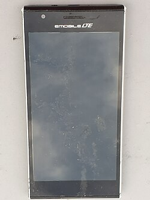

# Mi346: Warum alle bei einem neuen Wort zu einem Kugelfisch-Bild nur die Kugelfische meinen

Aus der Folge „Mi346 – "Powered Pants"“ von [Methodisch inkorrekt!](http://www.minkorrekt.de) vom 20.05.2025.

Das Experiment steht in der Folge 1:11:50 bis 1:22:14 (nach den Kapitelmarken).

Interessen: Spiele und Karten Tiere und Pflanzen

Fachgebiet: Wahrnehmung und Psychologie

Material: Papier und Karton <small lang="en">paper and cardboard</small> Smartphone, Computer, Bildschirm <small lang="en">smartphone, computer, electronic visual display</small>

[Bilder und ihre Quellen](../materials.md)

## Zusammenfassung

- **Was man tut:** Man zeigt jemandem ein Bild von einem Kugelfisch und sagt, das sei ein Ogo. Danach zeigt man eine 3x3-Matrix aus Emojis und fragt, wo die Ogos sind. (1:12:43) <!-- cite mi-346 ⏱4363.9 paragraph ⏱4363.9 -->
- **Was man braucht:** Man braucht zwei Bilder: einen einzelnen Kugelfisch und ein Raster mit drei Kugelfischen, anderen Fischen, Ratte, Hund und Palme. Außerdem braucht man eine Person, die das Experiment nicht kennt. (1:12:01) <!-- cite mi-346 ⏱4321.2 paragraph ⏱4321.2 -->
- **Was passiert:** Die Person markiert nur die drei Kugelfische. Dabei hat nie jemand gesagt, dass Ogo nicht auch alle Fische, alle Lebewesen oder runde Dinge meinen könnte. (1:13:18) <!-- cite mi-346 ⏱4398.8 paragraph ⏱4398.8 -->

Warum? (zum Aufklappen)

<strong>Warum:</strong> Das ist der Blowfish-Effekt (Paper von 2019): Ein neues Wort ordnet man automatisch in die engste bekannte Kategorie ein. Je ungewöhnlicher das Beispiel ist, desto enger fasst man das Wort, und das gilt bei Kindern wie bei Erwachsenen. (1:14:45) <!-- cite mi-346 ⏱4485.8 paragraph ⏱4485.8 -->

Die Zeiten in Klammern zeigen, wo die Folge davon spricht.

[Zur Übersicht](../index.md)

<!-- Generated by pac publish experiments. Do not edit; the next run overwrites it. -->
