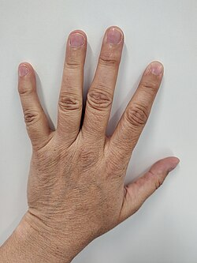

# Material und Bildquellen

Was man für die Experimente braucht, in Klassen von Dingen, die man zu Hause hat. Jedes Bild ist gemeinfrei oder steht unter CC0 und kommt von Wikimedia Commons.

<ul class="materials">
<li id="m_water"><b>Wasser</b>: Leitungswasser, Wasserglas-Wasser, heißes Wasser. <small><a href="https://commons.wikimedia.org/wiki/File:Glass_of_Water_(50838445027).jpg">Bild</a>, Alabama Extension, <a href="https://creativecommons.org/publicdomain/zero/1.0/">CC0</a></small></li>
<li id="m_ice"><b>Eis</b>: Eiswürfel, Crushed Ice, Kühlschrank-Eis. <small><a href="https://commons.wikimedia.org/wiki/File:%D8%AB%D9%84%D8%AC_%D8%B5%D9%86%D8%A7%D8%B9%D9%8A_3.jpg">Bild</a>, ديفيد عادل وهبة خليل 2, <a href="https://creativecommons.org/publicdomain/zero/1.0/">CC0</a></small></li>
<li id="m_salt"><b>Salz</b>: Kochsalz, Tafelsalz, Streusalz. <small><a href="https://commons.wikimedia.org/wiki/File:Salt-crystals.jpg">Bild</a>, Nate Steiner, <a href="https://creativecommons.org/publicdomain/zero/1.0/">CC0</a></small></li>
<li id="m_sugar"><b>Zucker</b>: Zucker, Würfelzucker, Puderzucker. <small><a href="https://commons.wikimedia.org/wiki/File:Sugarcubes.jpg">Bild</a>, Pallbo, <a href="https://creativecommons.org/publicdomain/mark/1.0/">gemeinfrei</a></small></li>
<li id="m_vinegar"><b>Essig und Säure</b>: Essig, Zitrone, Cola. <small><a href="https://commons.wikimedia.org/wiki/File:Vinegar_%26_Oil.JPG">Bild</a>, haitham alfalah, <a href="https://creativecommons.org/publicdomain/zero/1.0/">CC0</a></small></li>
<li id="m_baking_soda"><b>Backpulver und Natron</b>: Backpulver, Natron, Brausepulver. <small><a href="https://commons.wikimedia.org/wiki/File:Sodium_bicarbonate_CN_brightened.png">Bild</a>, Tszrkx, <a href="https://creativecommons.org/publicdomain/zero/1.0/">CC0</a></small></li>
<li id="m_oil"><b>Speiseöl</b>: Speiseöl, Sonnenblumenöl, Olivenöl. <small><a href="https://commons.wikimedia.org/wiki/File:Bottle_of_olive_oil.jpg">Bild</a>, margenauer from Pixabay, <a href="https://creativecommons.org/publicdomain/zero/1.0/">CC0</a></small></li>
<li id="m_food"><b>Andere Lebensmittel</b>: Milch, Cornflakes, Sekt, Kaffee, Tee, Eier, Obst, Bier. <small><a href="https://commons.wikimedia.org/wiki/File:Soldier%27s_Son-_Pregnancy_and_Childbirth_in_Wartime,_Bristol,_England,_1942_D10444.jpg">Bild</a>, Richard Stone, <a href="https://creativecommons.org/publicdomain/mark/1.0/">gemeinfrei</a></small></li>
<li id="m_dish_soap"><b>Spülmittel und Seife</b>: Spülmittel, Seife, Duschgel. <small><a href="https://commons.wikimedia.org/wiki/File:Soap_in_blue_dish.JPG">Bild</a>, TheLewisRepublic, <a href="https://creativecommons.org/publicdomain/mark/1.0/">gemeinfrei</a></small></li>
<li id="m_glass"><b>Glas und Flasche</b>: Gläser, Flaschen, Gläser mit Deckel. <small><a href="https://commons.wikimedia.org/wiki/File:Beer_bottles_2018_G1.jpg">Bild</a>, George Chernilevsky, <a href="https://creativecommons.org/publicdomain/mark/1.0/">gemeinfrei</a></small></li>
<li id="m_cup"><b>Becher, Tasse, Schüssel, Topf</b>: Becher, Tasse, Schüssel, Topf, Behälter. <small><a href="https://commons.wikimedia.org/wiki/File:PlainMug.jpg">Bild</a>, Henning Makholm at English Wikipedia, <a href="https://creativecommons.org/publicdomain/mark/1.0/">gemeinfrei</a></small></li>
<li id="m_cutlery"><b>Löffel und Besteck</b>: Löffel, Gabel, Messer. <small><a href="https://commons.wikimedia.org/wiki/File:HK_MK_%E6%97%BA%E8%A7%92_Mong_Kok_%E5%A5%B6%E8%B7%AF%E8%87%A3%E8%A1%97_6_Nelson_Street_%E5%BD%8C%E6%95%A6%E9%81%93_636_Nathan_Road_%E6%B0%B8%E9%9A%86%E9%8A%80%E8%A1%8C%E4%B8%AD%E5%BF%83_CMB_Wing_Lung_Bank_Centre_shop_%E8%8A%B1%E5%9C%92%E9%A4%90%E5%BB%B3_Sweetheart_Garden_Restaurant_%E5%88%80_knife_%E5%8F%89_fork_%E9%90%B5%E5%8C%99_spoon_tableware_October_2025_N13P_04.jpg">Bild</a>, FHSING MAgasdk, <a href="https://creativecommons.org/publicdomain/zero/1.0/">CC0</a></small></li>
<li id="m_paper"><b>Papier und Karton</b>: Papier, Karton, Pappe, Küchenrolle. <small><a href="https://commons.wikimedia.org/wiki/File:Scattered_white_paper_(Unsplash).jpg">Bild</a>, Brandi Redd brandi1, <a href="https://creativecommons.org/publicdomain/zero/1.0/">CC0</a></small></li>
<li id="m_foil"><b>Alufolie und Folie</b>: Alufolie, Frischhaltefolie. <small><a href="https://commons.wikimedia.org/wiki/File:HK_%E9%A6%99%E6%B8%AF%E8%88%AA%E7%A9%BA_HongKong_Airlines_%E9%A3%9B%E6%A9%9F%E9%A4%90_in-flight_meal_food_%E8%93%AE%E8%93%89%E5%8C%85_Lotus_seed_bun_with_%E9%8B%81%E7%AE%94%E7%B4%99%E8%A2%8B_disposable_aluminium_foil_January_2025_R12S_40.jpg">Bild</a>, Naha Mama Pavilionz, <a href="https://creativecommons.org/publicdomain/zero/1.0/">CC0</a></small></li>
<li id="m_string"><b>Schnur, Faden, Gummiband</b>: Schnur, Faden, Gummiband. <small><a href="https://commons.wikimedia.org/wiki/File:Twine_03.jpg">Bild</a>, Shams948, <a href="https://creativecommons.org/publicdomain/zero/1.0/">CC0</a></small></li>
<li id="m_balloon"><b>Luftballon</b>: Luftballon. <small><a href="https://commons.wikimedia.org/wiki/File:Toy_balloons_2011_G2.jpg">Bild</a>, George Chernilevsky, <a href="https://creativecommons.org/publicdomain/mark/1.0/">gemeinfrei</a></small></li>
<li id="m_candle"><b>Kerze, Teelicht, Feuerzeug</b>: Kerze, Teelicht, Feuerzeug, Streichhölzer. <small><a href="https://commons.wikimedia.org/wiki/File:Varmeljus.jpg">Bild</a>, No machine-readable author provided. Entheta assumed (based on copyright claims…, <a href="https://creativecommons.org/publicdomain/mark/1.0/">gemeinfrei</a></small></li>
<li id="m_magnet"><b>Magnet</b>: Magnet, Kühlschrankmagnet. <small><a href="https://commons.wikimedia.org/wiki/File:Neodym_Magnete.jpg">Bild</a>, No machine-readable author provided. Dalvin assumed (based on copyright claims)., <a href="https://creativecommons.org/publicdomain/mark/1.0/">gemeinfrei</a></small></li>
<li id="m_battery"><b>Batterie und Kabel</b>: Batterie, Kabel, Lämpchen. <small><a href="https://commons.wikimedia.org/wiki/File:IKEA_LADDA_rechargeable_AA-batteries.jpg">Bild</a>, RAIL P ( RAIL.PHOTOGRAPHY ), <a href="https://creativecommons.org/publicdomain/zero/1.0/">CC0</a></small></li>
<li id="m_light"><b>Lampe und Taschenlampe</b>: Lampe, Taschenlampe. <small><a href="https://commons.wikimedia.org/wiki/File:Small_black_flashlight.jpg">Bild</a>, Kathy Zinn, <a href="https://creativecommons.org/publicdomain/zero/1.0/">CC0</a></small></li>
<li id="m_phone"><b>Smartphone, Computer, Bildschirm</b>: Smartphone, Computer, Bildschirm. <small><a href="https://commons.wikimedia.org/wiki/File:EMOBILE_LTE_phone_in_Japan.jpg">Bild</a>, Syced, <a href="https://creativecommons.org/publicdomain/zero/1.0/">CC0</a></small></li>
<li id="m_straw"><b>Strohhalm</b>: Strohhalm, Trinkhalm. <small><a href="https://commons.wikimedia.org/wiki/File:Straws-8001.jpg">Bild</a>, https://pixabay.com/fr/users/Hans-2/, <a href="https://creativecommons.org/publicdomain/zero/1.0/">CC0</a></small></li>
<li id="m_small_items"><b>Kleinteile</b>: Münzen, Schrauben, Muttern, Büroklammern. <small><a href="https://commons.wikimedia.org/wiki/File:Paper-clips_colored.JPG">Bild</a>, Malubame, <a href="https://creativecommons.org/publicdomain/mark/1.0/">gemeinfrei</a></small></li>
<li id="m_appliance"><b>Haushaltsgerät</b>: Herd, Mikrowelle, Kühlschrank, Gefrierfach. <small><a href="https://commons.wikimedia.org/wiki/File:Microwave_oven_%22Erisson%22.jpg">Bild</a>, Karamanskaya, <a href="https://creativecommons.org/publicdomain/zero/1.0/">CC0</a></small></li>
<li id="m_bag_scissors"><b>Beutel, Schere, Klebeband</b>: Beutel, Schere, Klebeband. <small><a href="https://commons.wikimedia.org/wiki/File:Scissors_-_PD.jpg">Bild</a>, n.raveender, <a href="https://creativecommons.org/publicdomain/mark/1.0/">gemeinfrei</a></small></li>
<li id="m_measure"><b>Thermometer, Waage, Messbecher</b>: Thermometer, Waage, Messbecher, Lineal. <small><a href="https://commons.wikimedia.org/wiki/File:Kitchen_scale_20101110.jpg">Bild</a>, Batholith ( talk ), <a href="https://creativecommons.org/publicdomain/mark/1.0/">gemeinfrei</a></small></li>
<li id="m_game"><b>Kartenspiel, Würfel, Brettspiel</b>: Kartenspiel, Würfel, Brettspiel. <small><a href="https://commons.wikimedia.org/wiki/File:Dadi_poker.jpg">Bild</a>, Ricce, <a href="https://creativecommons.org/publicdomain/mark/1.0/">gemeinfrei</a></small></li>
<li id="m_laser"><b>Laserpointer</b>: Laserpointer, Laser. <small><a href="https://commons.wikimedia.org/wiki/File:Lasers-_Risks_%26_Benefits_(8169993658).jpg">Bild</a>, The U.S. Food and Drug Administration, <a href="https://creativecommons.org/publicdomain/mark/1.0/">gemeinfrei</a></small></li>
<li id="m_alcohol"><b>Alkohol und Spiritus</b>: Isopropanol, Ethanol, Brennspiritus. Steht zusammen mit Braucht Spezialmaterial. <small><a href="https://commons.wikimedia.org/wiki/File:CUEROS_(15).jpg">Bild</a>, Maarazul, <a href="https://creativecommons.org/publicdomain/zero/1.0/">CC0</a></small></li>
<li id="m_syringe"><b>Spritze</b>: Spritze, Einwegspritze ohne Nadel. Steht zusammen mit Braucht Spezialmaterial. <small><a href="https://commons.wikimedia.org/wiki/File:Improperly_Discarded_%E2%80%98Sharps%E2%80%99_Can_Be_Dangerous_(6321875537).jpg">Bild</a>, The U.S. Food and Drug Administration, <a href="https://creativecommons.org/publicdomain/mark/1.0/">gemeinfrei</a></small></li>
<li id="m_sand"><b>Sand</b>: Sand, Vogelsand, Quarzsand. <small><a href="https://commons.wikimedia.org/wiki/File:Sea_beach_sand_in_a_hand_closeup_(42621473960).jpg">Bild</a>, freestocks.org from Olsztyn, Poland, <a href="https://creativecommons.org/publicdomain/zero/1.0/">CC0</a></small></li>
<li id="m_body_only"><b>Nur der eigene Körper</b>: Man braucht kein Material, nur den eigenen Körper. Steht allein, nie mit einem anderen Material-Tag. <small><a href="https://commons.wikimedia.org/wiki/File:Human_hand.jpg">Bild</a>, FrognerSvart, <a href="https://creativecommons.org/publicdomain/zero/1.0/">CC0</a></small></li>
<li id="m_special"><b>Braucht Spezialmaterial</b>: Man braucht etwas, das man in einem normalen Haushalt nicht hat, zum Beispiel Isopropanol, einen Neodym-Magneten, einen Plattenspieler, eine Spritze, Bastelperlen, einen Laser oder einen Silberlöffel. Steht zusätzlich zum Klassen-Tag, wenn das Ding eine besondere Form einer Klasse ist. <small><a href="https://commons.wikimedia.org/wiki/File:Birnenkolben.jpg">Bild</a>, Tinux, <a href="https://creativecommons.org/publicdomain/zero/1.0/">CC0</a></small></li>
</ul>

[Zur Übersicht](index.md)

<!-- Generated by pac publish experiments. Do not edit; the next run overwrites it. -->
